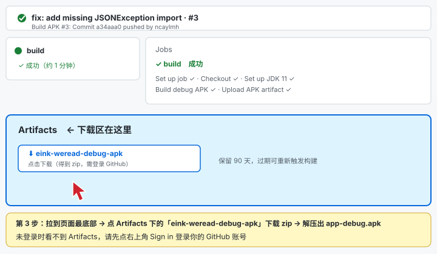

# eink-weread — Kindle KPW3（安卓 4.4.2 刷机版）微信读书独立 App

## 〇、先说结论：两条路线

| 路线 | 说明 | 成本 |
|------|------|------|
| **路线 A（推荐先试）**：KOReader + weread.koplugin 插件 | 开源项目 `finlater/weread.koplugin`（900+ star，2026 年仍活跃更新），在 KOReader 里直接读微信读书书架、公众号文章，支持扫码登录、进度同步、划线想法。**你已有官方 API Key，直接可用** | 只需安装 APK，零编译 |
| **路线 B（本项目）**：原生独立 App | 本工程是一个针对 **Android 4.4.2** 的原生微信读书客户端：扫码登录 + Skill 网关书架 + 原生分页墨水屏阅读器。协议层移植自上述插件的 Lua 实现 | 需编译一次 APK |

## 一、路线 A：KOReader + weread.koplugin（先试这个）

1. 给 KPW3 安装 KOReader（Android 版 APK）。
2. 从 https://github.com/finlater/weread.koplugin/releases 下载最新 `weread.koplugin-vX.Y.Z.zip`，
   解压放进 KOReader 的 `plugins/weread.koplugin/` 目录，重启 KOReader。
3. 菜单 `工具 → 微信读书 → 微信扫码登录`：用手机微信扫屏幕上的二维码确认；
   如手机显示 4 位验证码，在 KOReader 里输入即可。
4. 插件要求 KOReader 2026.03+。**注意**：最新版 KOReader 对 Android 4.4.2 的兼容性需要实测，
   若新版跑不起来，这条路就转路线 B。

## 二、路线 B：本工程（原生 App，Android 4.4.2）

### 架构（无 WebView 依赖）

4.4.2 的系统 WebView 停在 Chromium 30，跑不了微信读书网页版，所以本工程
**全部用原生 HTTP + 原生排版**：

```
LoginActivity    扫码登录
  GET  https://weread.qq.com/r/weread-skills     收集 session cookie
  GET  /api/auth/getLoginUid                     取 uid → 生成二维码（ZXing）
  GET  /api/auth/getLoginInfo?uid=&otp=          轮询（支持 4 位验证码 NEED_OTP）
  →    保存 wr_vid / wr_skey / wr_rt

MainActivity     书架
  POST https://i.weread.qq.com/api/agent/gateway 官方 Skill 网关
       header: Authorization: Bearer <你的 API Key>
       body:   {"api_name":"/shelf/sync","skill_version":"1.0.5"}

ReaderActivity   阅读
  POST /web/book/chapterInfos                    章节目录
  GET  /web/reader/<e(bookId)>k<e(chapterUid)>   提取 psvts 会话令牌
  POST /web/book/chapter/e_0|e_1|e_3             章节分片（b/c/r/ct/ps/pc/st/s 签名参数）
  →    32 字节 MD5 校验头 + 首字符丢弃 + 字符交换还原 + URL-safe Base64 → XHTML → 纯文本
PageView         原生分页渲染（StaticLayout 按行切页，音量键/点按翻页，无动画）
```

关键移植点（Lua → Java，源码在 `WeRead.java`）：
- `sign()`：0x15051505 双游标从串尾步进的异或移位签名
- `e()`：MD5 + 数字分块 / 逐字节 hex（无零填充）混淆
- 分片解码：尾部 ≤4 字节按 4 进制解释生成至多 10 个交换位置，逆序还原后再 Base64
- **TLS 1.2**：4.4.2 的 HttpURLConnection 默认不启用，`Http.java` 静态块强制开启，否则全部握手失败

### 编译

```bash
cd eink-weread
gradle assembleDebug     # 或用 Android Studio 打开本目录
# 产物：app/build/outputs/apk/debug/app-debug.apk
```

### 不想本地编译？GitHub 云端构建 + 网页下载 APK（零环境）

仓库已带 `.github/workflows/build.yml`：**push 代码后 GitHub 会自动构建**，网页上直接下载成品 APK。

**网页操作步骤（配示意图）：**

1. 打开仓库页面 `github.com/ncaylmh/kindle_kpw3_weread_test`，
   点击顶部的 **「Actions」** 标签；左侧点 **Build APK** 工作流，
   右侧点最新一条 **绿色 ✓** 的构建记录（红色 ✗ 是失败的旧记录，不用管）：

   

2. 进入构建详情页后，**拉到页面最底部**的 **Artifacts** 区域，
   点击 **`eink-weread-debug-apk`** 下载（得到 zip，解压出 `app-debug.apk`）：

   

**注意事项：**
- **Artifacts 需要先登录 GitHub 账号**（右上角 Sign in），否则看不到下载区；
- Artifacts **保留 90 天**，过期后让仓库重新构建一次即可（进 Actions → Build APK → 右上 **Run workflow** 按钮手动触发，或 push 任意提交）；
- 国内网络访问 GitHub 时好时坏，打不开时换个时段或网络再试；
- 以后每次改代码 push，GitHub 自动出新 APK，同一位置下载。

依赖：Android SDK（API 28 编译即可）、Gradle 6.7+、`com.google.zxing:core:3.4.1`（纯 Java，自动下载）。

### 使用

1. 安装 APK → 启动 → 自动进入扫码登录 → 手机微信扫码（必要时输入 4 位验证码）。
2. 回到书架，**菜单键 → 设置 API Key**，粘贴手机微信读书 App 里
   `我 → 设置 → 微信读书 Skill → 获取 API Key` 的密钥。
3. 点书进入阅读：音量键 / 点按翻页（左 1/3 上一页），返回键退出。

### 互动功能（阅读页菜单键）

| 功能 | 实现 | 接口 |
|------|------|------|
| 阅读进度恢复 | 打书时拉取云端进度，按章内百分比近似定位 | `GET /web/book/getProgress` |
| 查看本章划线 | 自己与好友在该章的划线 | gateway `/book/underlines` |
| 查看热门划线 | 全书高赞划线 | `GET /book/bestbookmarks` |
| 查看本章想法 | 按划线 range 批量拉取想法 | gateway `/book/readreviews`（每批≤30） |
| 查看全书书评 | 热门书评列表 | gateway `/review/list` |
| **正文选中划线** | ✅ 长按选中段落（浅灰高亮），"调整选区"模式下单击扩展/收缩，写入时由显示文本→官方坐标映射计算 `range` | `POST /web/book/addBookmark`（失败回退 `i.weread.qq.com/book/addBookmark`） |
| **发表想法** | ✅ 挂句子的想法（abstract=选中文本+range）或章节级想法（range=`"0-0"`） | `POST /web/review/add`（失败回退 `i.weread.qq.com/review/add`） |
| 点赞书评 | 预留接口 `Api.likeReview()` | `POST /review/like` |
| **时长上报** | 首次 `enter_read`，之后每 30 秒 `report_read`（携带章内偏移与百分比，**服务端同时记时长+同步进度**）；失败自动 `/web/login/renewal` 续期（10 分钟冷却），`x-wr-ticket`/`x-wrpa-0` 凭据自动捕获回传 | `POST /web/book/read` |

### 划线坐标系与校准（重要）

官方坐标系（coweread 项目 2026-08/09 实测）：

- 划线 `range = "start-end"`，**左闭右开**，是**章节内字符偏移**（每章从 0 计数）；
  例：46 字的划线若起点坐标 1000，则 range=`"1000-1046"`。
- 官方把空格等不可见字符也计入坐标（网页端每个字符包在 span 里带 `data-wr-co`）。
- 本工程的实现：`WeRead.htmlToText(html, coordMap)` 把章节 XHTML **剥标签保留全部文本节点字符**
  作为坐标流，显示文本每个字符映射到坐标流下标；选区写入时
  `WeRead.rangeFor(coords, start, end)` 换算 `"start-end"`。
- **残留误差来源**：段落间 HTML 空白节点的计数方式可能与官方有少量偏差。为此，
  划线写入成功后会自动拉取 `GET /web/book/bookmarklist` 比对服务器实际保存的 range，
  若与本地计算不一致会 Toast 提示出两者数值——把偏差规律记下来后，只需微调
  `WeRead.coordAt()` 附近的偏移逻辑即可完成校准。

### 与手机端 App 的差距（诚实清单）

- **笔记管理/导出**：可加"我的想法/我的划线"页（`Api.fetchMyThoughts()`、
  `Api.fetchMyBookmarks()` 已封装，UI 未挂）。
- **划线样式（波浪线/底色多选）、想法点赞/回复流**：查看侧已覆盖，互动侧仅预留点赞。
- **AI 问书 / 听书 / 推送 / 私信 / 好友排行**：依赖客户端私有长连接或付费能力，不做。
- **图片类书籍/漫画**：分片解码目前只出文本，图片分片（chapter.tar）未处理。

### 已知风险（务必阅读）

1. **协议变更风险**：章节分片接口与签名算法依赖微信读书线上版本，若官方改版需要
   参照 `finlater/weread.koplugin` 的最新实现同步更新 `WeRead.java`。
2. **风控风险**：老 UA + 高频轮询可能触发风控；轮询已控制在 1.5 秒/次。
   如遇账号异常请立即停止使用。本项目仅供个人学习，勿商用。
3. **4.4.2 TLS**：已强制启用 TLSv1.2，但老 ROM 的证书信任链若过旧（ISRG Root 缺失等）
   可能报证书错误，届时需在 `Http.java` 中补装根证书或放宽校验（自行承担风险）。
4. 书架接口依赖 API Key 权限范围；进度同步、笔记等高级功能未实现，可参照插件
   的 `progress_sync.lua` 扩展（gateway 名称：`/book/getprogress` 等）。
